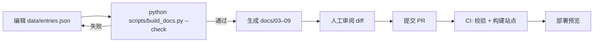

# 内容模型与数据契约

> 原则：**数据是唯一事实来源**。文档、页面、图表都从 `data/*.json` 派生。
> 只要数据能通过校验，页面就不可能出现「年份对不上」「少一条」「字段拼错」这类问题。

---

## 1. 数据文件

| 文件 | 内容 | 消费者 |
|---|---|---|
| `data/entries.json` | 124 条代表作（120 核心 + 4 观察） | 文档生成脚本、站点构建 |
| `data/periods.json` | 六期定义、边界、主色 | 文档生成脚本、站点构建 |
| `data/glossary.json`（待建） | 术语表 | 方法页 |
| `src/content/periods/*.mdx`（待建） | 六篇长文 | 时期页 |
| `src/content/works/*.mdx`（待建） | 长赏析（超过 800 字时） | 详情页 |

---

## 2. 枚举

```ts
export const KIND = ["anime", "manga", "game", "illustration"] as const;
export const PERIOD = ["P1", "P2", "P3", "P4", "P5", "P6"] as const;
export const FACET = [
  "line", "eye", "face", "color", "body", "hair", "staging", "texture", "proportion",
] as const;
export const STATUS = ["core", "provisional"] as const;
export const CONFIDENCE = ["high", "medium", "low"] as const;
```

**标签（tags）是受控词表**，不允许自由发挥。第一版词表：

```
细线 太线 粗轮廓 松弛线条 线密度 色トレス
大眼 极小鼻口 瞳孔符号 多重高光 虹膜分层
圆脸 长脸 方颌 鼻梁消失 留白
赛璐璐 动画涂 透明上色 厚涂 水彩 撞色 低饱和 高对比
长身 细身 幼态 写实比例 夸张变形
天使环 发丝分级 大色块
平面化 摄影化 复古 和风 中华风 哥特 美式影响
3D 赛璐璐3D 跨媒体 实验 反精致 记号化 信息量 去装饰 全球化
轻小说插画 美少女游戏 VOCALOID VTuber SNS
```

> 新增标签必须同时更新这份词表与 `scripts/build_docs.py` 的校验（见 §6）。

---

## 3. Entry 结构（Zod 定义）

```ts
import { z } from "astro/zod";

const localizedTitle = z.object({
  zh: z.string().min(1).max(40),
  ja: z.string().max(80).optional(),
  en: z.string().max(120).optional(),
});

export const entrySchema = z.object({
  id: z.string().regex(/^\d{4}-[a-z0-9-]+$/),           // 1996-eva
  year: z.number().int().min(1996).max(2026),
  yearNote: z.string().max(60).optional(),               // 跨年说明
  period: z.enum(PERIOD),
  kind: z.enum(KIND),

  zh: z.string().min(1).max(40),
  ja: z.string().max(80).optional(),
  en: z.string().max(120).optional(),

  creator: z.string().max(60).nullable().optional(),     // 监督 / 作者 / 制作人
  designer: z.string().max(60).nullable().optional(),    // 角色设计 / 作画
  org: z.string().max(60).nullable().optional(),         // 制作公司 / 出版社
  rep: z.string().max(120).optional(),                   // 插画师：代表作

  facet: z.enum(FACET),
  tags: z.array(z.string()).max(6),

  why: z.string().min(20).max(140),                      // 入选理由（一句话）
  analysis: z.string().max(2000).optional(),             // 详情页长文（可后补）
  annotations: z.array(z.object({
    x: z.number().min(0).max(100),
    y: z.number().min(0).max(100),
    text: z.string().max(40),
    dimension: z.enum(FACET),
  })).max(6).optional(),

  images: z.array(z.object({
    src: z.string(),
    alt: z.string().max(120),
    credit: z.string().max(120),                         // 出处（法务必需）
    ratio: z.enum(["3:4", "16:9", "1:1"]),
  })).optional(),

  sources: z.array(z.object({
    label: z.string().max(80),
    url: z.string().url().optional(),
  })).max(8).optional(),

  status: z.enum(STATUS),
  confidence: z.enum(CONFIDENCE),
  order: z.number().int().min(0).max(99).optional(),     // 同年内的手动排序，默认 50
  updatedAt: z.string().optional(),                      // ISO 日期
});
```

### 字段说明

| 字段 | 必需 | 约束 | 说明 |
|---|---|---|---|
| `id` | ✅ | `^\d{4}-[a-z0-9-]+$` | 年份 + 短横线 slug；一经发布**不可改**（会破坏链接） |
| `year` | ✅ | 1996–2026 | 「研究归属年」，不一定是首播年 |
| `yearNote` | ❌ | ≤60 字 | 跨年、海外传播滞后时说明 |
| `period` | ✅ | P1–P6 | 必须与 `periods.json` 的区间一致 |
| `kind` | ✅ | 四类 | `illustration` 时 `zh` 是**人名**，`rep` 是代表作 |
| `zh/ja/en` | zh 必需 | — | 中文名优先；日文原名保留；英文名可选 |
| `creator` | ❌ | ≤60 字 | 动画填监督，漫画填作者，游戏填制作人 |
| `designer` | ❌ | ≤60 字 | 角色设计 / 作画监督；**这是画风研究的关键字段** |
| `org` | ❌ | ≤60 字 | 制作公司 / 出版社 / 开发公司 |
| `facet` | ✅ | 九维度 | 该条目**最适合说明**的维度（只选一个） |
| `tags` | ✅ | ≤6，受控词表 | 用于筛选与关联 |
| `why` | ✅ | 20–140 字 | 必须包含「画法」而不只是「评价」 |
| `analysis` | ❌ | ≤2000 字 | 详情页正文；短的可直接放这里 |
| `annotations` | ❌ | ≤6 | 图片热点，坐标为百分比 |
| `images` | ❌ | — | 每张必须有 `credit` |
| `sources` | ❌ | ≤8 | `confidence` 为 medium/low 时**建议必填** |
| `status` | ✅ | core/provisional | 观察位见 `09` |
| `confidence` | ✅ | high/medium/low | 见 `00` §4.4 |
| `order` | ❌ | 0–99，默认 50 | 同年内的手动排序（如把 EVA 排在 1996 的第一位） |

---

## 4. Period 结构

```ts
export const periodSchema = z.object({
  id: z.enum(PERIOD),
  code: z.enum(PERIOD),
  range: z.tuple([z.number(), z.number()]),
  label: z.string(),            // "2010–2014"
  name: z.string(),             // "信息量爆炸"
  subname: z.string(),          // "瞳的多重高光、肌肤的渐变…"
  oneLiner: z.string().max(120),
  accent: z.string().regex(/^#[0-9A-Fa-f]{6}$/),
  keywords: z.array(z.string()).max(8),
});
```

`periods.json` 还包含：

- `origin`：起点（EVA）的说明，不计入六期。
- `boundaries`：五条边界的模糊区间与判断锚点。

---

## 5. 关系模型

```
period 1 ─── n entry          （entry.period）
entry  1 ─── 1 facet          （用于「看哪里」与筛选）
entry  n ─── n tag            （受控词表）
entry  n ─── n entry          （同年 4 件 —— 由 year 派生，不存字段）
entry  n ─── n period         （过渡作品 —— 由 boundaries 派生，不存字段）
```

**刻意不存的字段**：

| 不存 | 理由 |
|---|---|
| `sameYear: [...]` | 由 `year` 派生，存了会不一致 |
| `prevId` / `nextId` | 由排序派生 |
| `periodName` | 存在 `periods.json`，避免重复 |
| `animeCount` 等统计 | 构建期计算 |

---

## 6. 校验规则（CI 必须全部通过）

`python scripts/build_docs.py --check` 已实现前 7 条，其余在站点构建期由 Zod 与自定义校验补上。

| # | 规则 | 失败后果 |
|---|---|---|
| 1 | 每年恰好 4 条 | 构建失败 |
| 2 | `id` 唯一 | 构建失败 |
| 3 | `year` 在 `period.range` 内 | 构建失败 |
| 4 | 核心条目 = 120 条 | 构建失败 |
| 5 | 核心动画 ≥ 60 条 | 构建失败 |
| 6 | `zh` 唯一（同一作品不重复） | 构建失败 |
| 7 | `kind` 合法 | 构建失败 |
| 8 | `tags` 全部在受控词表内 | 构建失败 |
| 9 | `why` 长度 20–140 | 构建失败 |
| 10 | `analyssis` 超过 2000 字时必须拆到 MDX | 构建失败 |
| 11 | 核心条目至少 1 张图 + 1 条 `credit` | 上线前失败 |
| 12 | `confidence != high` 必须有 `sources` | 上线前失败 |
| 13 | 同一 `creator` 出现 ≤3 次 | 警告（不阻断） |
| 14 | 每期至少 1 条插画或游戏 | 警告 |

---

## 7. 一条完整示例

```json
{
  "id": "2012-hyouka",
  "year": 2012,
  "period": "P4",
  "kind": "anime",
  "zh": "冰菓",
  "ja": "氷菓",
  "en": "Hyouka",
  "creator": "武本康弘（監督）",
  "designer": "西屋太志",
  "org": "京都アニメーション",
  "facet": "eye",
  "tags": ["虹膜分层", "多重高光", "写实比例", "信息量"],
  "why": "西屋太志把京阿尼的脸从『记号』改成『信息』：虹膜分层、睫毛分组、皮肤有通透感——10年代的分水岭。",
  "analysis": "……（≤2000 字，可直接渲染）",
  "annotations": [
    { "x": 42, "y": 38, "text": "虹膜分四层，边缘有一圈冷光", "dimension": "eye" },
    { "x": 55, "y": 62, "text": "鼻尖一小块暖色阴影，暗示皮下血色", "dimension": "color" }
  ],
  "images": [
    {
      "src": "/images/works/2012-hyouka/hero.avif",
      "alt": "冰菓 主角正面特写",
      "credit": "© 米澤穂信・角川書店／「氷菓」製作委員会",
      "ratio": "16:9"
    }
  ],
  "sources": [
    { "label": "TVアニメ「氷菓」公式サイト スタッフ", "url": "https://kotenbu.com/staffcast/" }
  ],
  "status": "core",
  "confidence": "high",
  "updatedAt": "2026-11-03"
}
```

---

## 8. 长文（MDX）约定

当赏析超过 800 字，或需要嵌入图表、对比滑块时，改用 MDX：

```
src/content/works/2012-hyouka.mdx
---
id: 2012-hyouka
---
<Lead>一句话</Lead>

## 看什么
…

<FacetTable facets={["eye","color"]} />
```

**规则**：

- MDX 的 `id` 必须能在 `entries.json` 里找到，构建期校验。
- MDX 只放**叙事**，结构化字段仍留在 JSON（单一事实来源）。
- 六篇时期长文同理：`src/content/periods/p4.mdx`，frontmatter 里只放 `id: P4`。

---

## 9. 版本与迁移

- `meta.version` 采用语义化版本：数据类型变更（增删字段）为 **major**，新增条目为 **minor**。
- `id` 一经发布不可修改。改名需求 → 新增 `aliases: []` 字段做重定向。
- 每次改动 `entries.json` 后必须重新运行 `python scripts/build_docs.py`，并在 PR 里附上生成文档的 diff。

---

## 10. 数据生产工作流



**三个不允许**：

1. 不允许手改 `docs/03–09`（会被下次生成覆盖）。
2. 不允许在页面里硬编码条目数据。
3. 不允许 `confidence: high` 但没有出处。

---

**上一节**：[视觉设计规范](13-视觉设计规范.md) ｜ **下一节**：[素材版权与引用规范](15-素材版权与引用规范.md)
